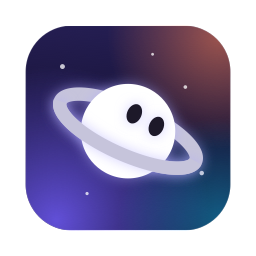
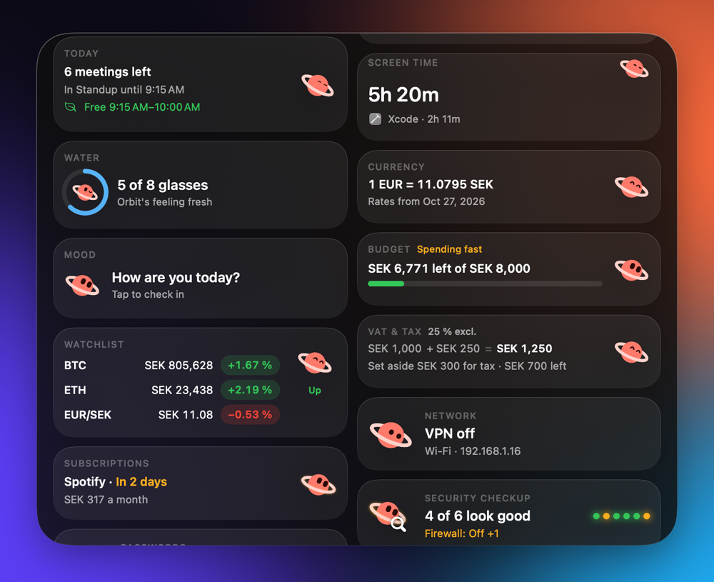
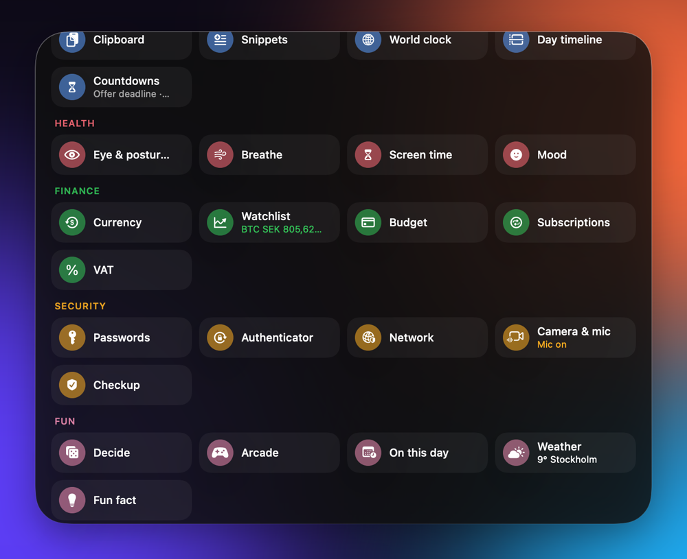
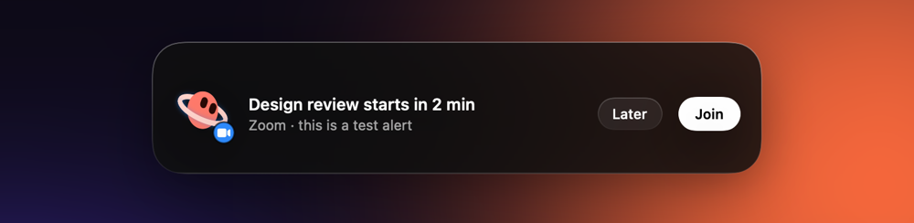
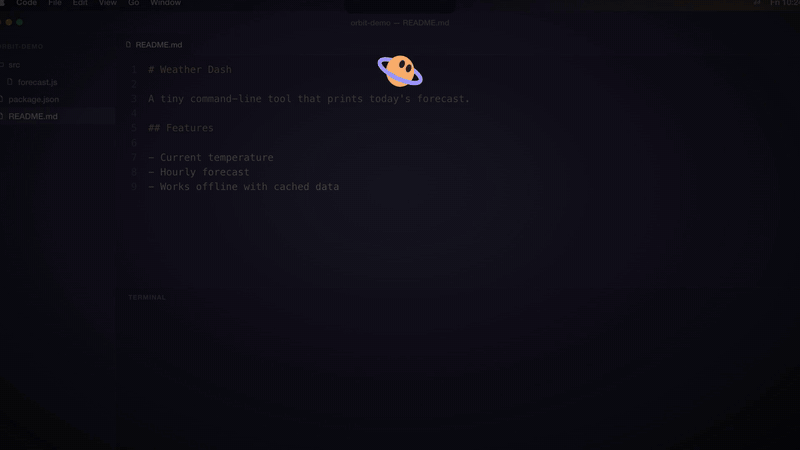
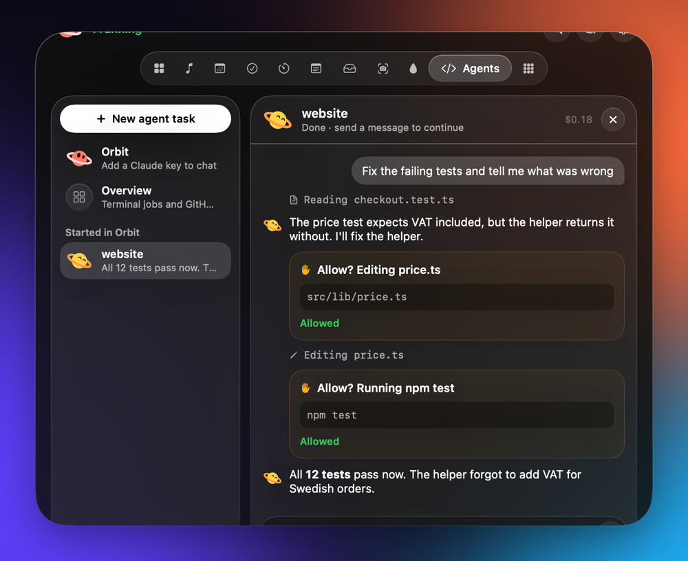
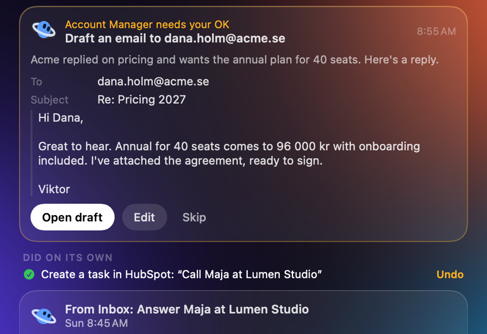
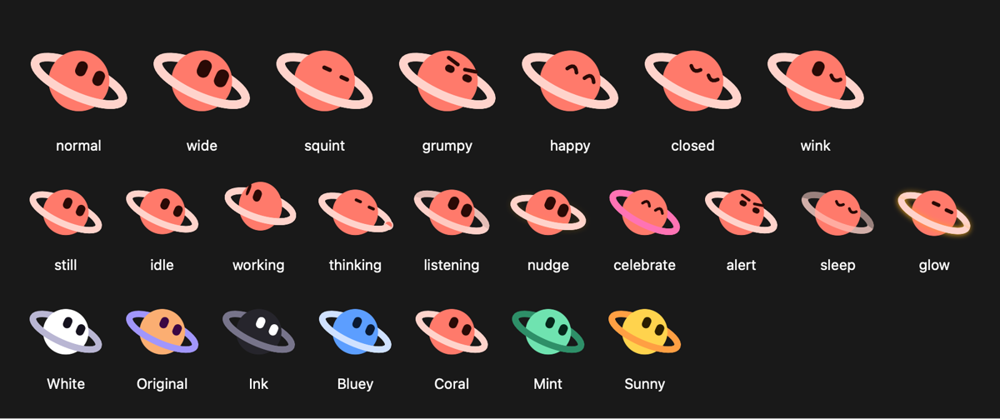

<p align="center">
  
</p>

<h1 align="center">Orbit</h1>

<p align="center">
  Your whole day, tucked in the MacBook notch.<br>
  Music, meetings, tasks, focus, files, your AI agents and bots. Free and open source.
</p>

<p align="center">
  <a href="https://github.com/vgawor/orbit-releases/releases/latest"><strong>Download for Mac</strong></a> ·
  <a href="#what-it-does">Features</a> ·
  <a href="#agents-approve-from-the-notch">Agents</a> ·
  <a href="#bots-ai-teammates-that-ask-first">Bots</a> ·
  <a href="#private-by-default">Privacy</a> ·
  <a href="docs/ADDONS.md">Add-ons</a> ·
  <a href="#build-it-yourself">Build</a>
</p>

<p align="center">
  <a href="https://github.com/vgawor/orbit-releases/releases/latest"></a>
  <a href="https://github.com/vgawor/orbit-releases/releases"></a>
  <a href="#install"></a>
  
  <a href="LICENSE"></a>
  <a href="https://github.com/vgawor/orbit/stargazers"></a>
</p>

<p align="center">
  
</p>

Hover the notch to peek, click to open. Orbit shows what's next, plays your music, runs your
focus timer and holds your files, and it taps you on the shoulder when something needs you: a
meeting starting, an AI agent asking to run a command, a bot with a draft ready for your OK.

No notch? On an external display Orbit floats as a glass pill under the menu bar and works the
same way. Liquid Glass on macOS 26, frosted blur on macOS 14 and 15.

<p align="center">
  
  
</p>

## Install

1. [Download the latest Orbit DMG](https://github.com/vgawor/orbit-releases/releases/latest) and
   drag Orbit to Applications.
2. Open it. macOS warns you once because Orbit isn't notarized by Apple: click **Done**.
3. Go to **System Settings → Privacy & Security** and click **Open Anyway**.

You only do this once. Orbit updates itself after that. Company-managed Macs may need IT to
allow it, or you can [build it yourself](#build-it-yourself).

## What it does

### Your day

- **Home.** A dashboard of cards: the next meeting with a Join button, free time, focus, music,
  tasks and any add-on you pick.
- **Meetings.** Your calendar with one-click Join for Zoom, Teams, Google Meet and Webex, and an alert in the
  notch two minutes before.
- **Music.** Spotify and Apple Music controls, with device switching for Spotify.
- **Tasks.** Local tasks, or HubSpot tasks with your own token. Type "Send offer to Northwind
  tomorrow 14:00" and Orbit fills in the form.
- **Timers and Focus.** Run several timers at once, or a 4 × 25 minute focus block with breaks.
- **Notes, Shelf and Capture.** Quick notes, a shelf to drop files on (AirDrop, convert), and
  screenshots or recordings of an area, window or screen.
- **Smart Ask.** Ask a question from anywhere and get the answer in the notch.
- **Mirror, Prompter, Draw, Mic safety and Presenting mode** for calls and talks.

<p align="center">
  
</p>

### Agents: approve from the notch

Start Claude Code on a task and approve each step from the notch: every file edit and every
command waits for your **Allow**. If you don't answer, it isn't allowed. Claude Code sessions in
your own terminal ask in the notch too, so you never switch tabs to say yes.

<p align="center">
  
</p>

<p align="center">
  
</p>

### Bots: AI teammates that ask first

Bots run on a schedule and report back in the notch: **Chief of Staff** writes your morning
brief, **Account Manager** follows up on your HubSpot deals, **Inbox** sorts what came in, and
you can make your own. They hand work to each other, and anything that changes something waits
for your OK. After you've approved the same kind of action a few times, Orbit offers to trust it,
with Undo for 10 minutes. Bots only touch HubSpot deals you own.

<p align="center">
  
</p>

### Add-ons

35 add-ons in seven categories (Productivity, Health, Finance, Security, Fun, Developers and AI),
from world clock and clipboard history to GitHub Actions, Docker, ports and uptime checks. They're
off until you turn them on. See the [full list](docs/ADDONS.md), or
[write your own](docs/SDK.md) as a small script in any language.

### Orbit itself

Orbit is a little planet with moods. It works, thinks, listens, celebrates and sleeps along with
you, in seven colours.

<p align="center">
  
</p>

## Private by default

- **Everything stays on your Mac** except what you connect yourself: Smart Ask and bots talk to
  Claude or ChatGPT with your key, Tasks talks to HubSpot with your token, and Agents reads your
  GitHub reviews.
- **No account, no telemetry.** Orbit Pro is optional (see below).
- **Permissions only when needed:** Calendar for meetings, Screen Recording for capture, Camera
  for the mirror, Microphone for mic safety, each asked the first time you use the feature.

## Free and Pro

Orbit is free and open source, and bots work with your own API key at no cost.
**Orbit Pro** ($12/month) is an optional account: bots run on Orbit's AI keys so you don't need
an API account, you approve them from your phone, and you get the Pro add-ons. Pro requests go
through Orbit's server to the AI provider and aren't stored there.

## Build it yourself

You need Xcode 26 (or its command line tools) on macOS 14 or later.

```bash
swift build --product Viktor    # the app
swift test                      # all tests
scripts/install.sh              # build Orbit.app and put it in /Applications
```

More in [docs/DEVELOPING.md](docs/DEVELOPING.md): screen snapshots, signing and releases.
The app is called Orbit; the source still uses its first working name, Viktor, for folders,
types and the `viktor` command-line tool.

## Contributing

Bug reports, fixes and add-ons are welcome. Read [CONTRIBUTING.md](CONTRIBUTING.md) first.
Security problems: see [SECURITY.md](SECURITY.md). If Orbit is useful to you, a ⭐ helps other
people find it.

## Licence

Apache License 2.0 ([LICENSE](LICENSE)), except the Pro add-ons, which are under the Functional
Source License ([LICENSE-PRO.md](LICENSE-PRO.md)) and become Apache-2.0 after two years. The Orbit
name and icon are trademarks ([TRADEMARKS.md](TRADEMARKS.md)).
